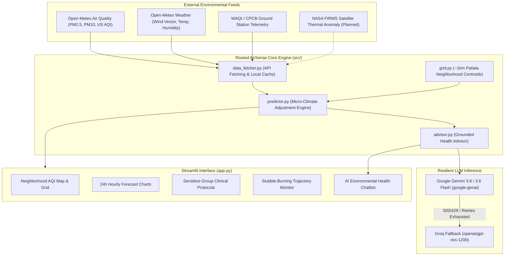

# Rooted AirSense 🌱

> **Hyperlocal Neighborhood Air Pollution Prediction & Environmental Health Advisory for Patiala, Punjab**  
> *Developed for the RootAccess Hackathon by Team Rooted*

---

## 📌 Problem Statement

Patiala and the broader Malwa region of Punjab endure severe seasonal air quality emergencies every autumn and winter. The air quality challenges are driven by a combination of factors:

1. **Agrarian Stubble Burning**: Paddy residue fires across upwind western districts (Sangrur, Barnala, Mansa, Bathinda, Moga) release massive pyrogenic aerosol plumes that are transported across district boundaries whenever winds blow from the West or South-West.
2. **Urban Micro-Climates**: A single central CPCB or government monitoring station cannot capture neighborhood-level variations. High-traffic commercial corridors (e.g. *Leela Bhawan*, *Tripuri*), industrial zones (*Focal Point*), and dense bazaar networks (*Qila Mubarak*) experience intense particulate traps, while urban forest sanctuaries (*Baradari Gardens*, *Thapar University campus*) offer natural bio-filtration.
3. **Public Health Gap**: Citizens, asthmatics, schools, and vulnerable populations lack actionable, hyperlocal guidance on when to ventilate, when to run, and when to keep children indoors.

---

## 💡 Our Solution

**Rooted AirSense** is an AI-powered, neighborhood-scale environmental intelligence platform tailored for Patiala, Punjab. 

- **Hyperlocal ~1km Spatial Mesh**: Disaggregates regional forecasts across Patiala's distinct urban micro-zones by factoring in road density, industrial proximity, green canopy mitigation, and upwind wind vectors.
- **Multimodal Data Fusion**: Combines real-time meteorological conditions, Open-Meteo hourly multi-pollutant projections, and live ground station feeds from WAQI / CPCB.
- **Resilient AI Health Advisor**: Leverages Google Gemini Flash (`gemini-3.8-flash` / `gemini-3.6-flash`) with automatic backoff retries and graceful fallback to Groq (`openai/gpt-oss-120b`), dynamically grounded on live neighborhood readings.

---

## 🏗️ System Architecture



---

## ✨ Key Features

- **📍 Neighborhood AQI Map & Grid (~1km Resolution)**:
  Interactive 3D/2D Pydeck spatial map mapping key Patiala zones: *Tripuri, Leela Bhawan, Model Town, Bhupindra Road, Urban Estate, Thapar University, Focal Point, Baradari Gardens, Qila Mubarak, and Punjabi University*.
- **📈 24-to-48 Hour Multi-Pollutant Forecast**:
  Hourly trajectory charts for PM2.5, PM10, US AQI, temperature, humidity, and wind velocity from Open-Meteo.
- **💬 AI Health & Action Advisor**:
  Conversational health companion grounded in live neighborhood data. Uses Google Gemini Flash with automatic 2-step exponential backoff (2s, 4s) and Groq fallback (`openai/gpt-oss-120b`). Shows which model answered under every reply.
- **🛡️ Sensitive-Group Health Alerts**:
  Targeted clinical advisories for school children, asthmatics/COPD patients, senior citizens, and outdoor joggers.
- **🌾 Stubble-Burning Smoke Influx Monitor**:
  Evaluates wind direction sector (200°–290° W/SW Malwa smoke corridor) and wind speed to project agricultural smoke transport.

---

## 🛠️ Tech Stack

| Component | Technologies |
|---|---|
| **Framework & UI** | [Streamlit](https://streamlit.io/), [Pydeck](https://deckgl.readthedocs.io/), [Altair](https://altair-viz.github.io/), Pandas |
| **Air Quality & Meteorology** | [Open-Meteo Air Quality & Weather API](https://open-meteo.com/), [WAQI API](https://aqicn.org/api/) |
| **AI / Large Language Models** | Google GenAI SDK (`google-genai`), OpenAI SDK (`openai` for Groq API) |
| **Primary Models** | Google `gemini-3.8-flash` (default), `gemini-3.6-flash`, `gemini-3.5-flash-lite` |
| **Fallback LLM** | Groq Cloud `openai/gpt-oss-120b` |
| **Language & Environment** | Python 3.10+, `python-dotenv`, Requests |

---

## 📊 Data Sources

1. **[Open-Meteo Air Quality API](https://open-meteo.com/en/docs/air-quality-api)**: Free hourly PM2.5, PM10, and US AQI forecasts.
2. **[Open-Meteo Weather API](https://open-meteo.com/en/docs)**: Free hourly wind speed, wind direction, temperature, and humidity.
3. **[World Air Quality Index (WAQI) / CPCB](https://aqicn.org/api/)**: Ground station monitoring data for Patiala.
4. **[OpenStreetMap](https://www.openstreetmap.org/)**: Road network density, green cover, and industrial land use data.
5. **[NASA FIRMS](https://firms.modaps.eosdis.nasa.gov/) *(Planned)*: Near-real-time VIIRS/MODIS satellite thermal fire detection across Punjab.

---

## 🚀 Setup & Installation

### 1. Clone the Repository
```bash
git clone https://github.com/your-username/rooted-rootaccess.git
cd rooted-rootaccess
```

### 2. Create and Activate Virtual Environment
```bash
# Windows
python -m venv .venv
.\.venv\Scripts\activate

# Linux / macOS
python3 -m venv .venv
source .venv/bin/activate
```

### 3. Install Dependencies
```bash
pip install -r requirements.txt
```

### 4. Configure Environment Variables
Copy `.env.example` to `.env`:
```bash
# Windows
Copy-Item .env.example .env

# Linux / macOS
cp .env.example .env
```
Edit `.env` and fill in your keys:
```env
# Google Gemini API Key (Required for AI Advisor)
GEMINI_API_KEY=your_gemini_api_key_here

# Groq API Key (Optional fallback)
GROQ_API_KEY=your_groq_api_key_here

# WAQI API Token (Optional for live ground station readings)
WAQI_TOKEN=your_waqi_api_token_here
```

### 5. Launch the Application
```bash
streamlit run app.py
```
Open your browser at `http://localhost:8501`.

---

## 👥 Team Rooted

*RootAccess Hackathon — Patiala, Punjab*

- **Sukhman Bhullar** — *Team Lead*
- **Harshveer Singh**
- **Gurleen Kaur**
- **Kushagra Babbar**
- **Yogita Modi**

---

## 📄 License
This project is licensed under the MIT License - see the [LICENSE](LICENSE) file for details.
